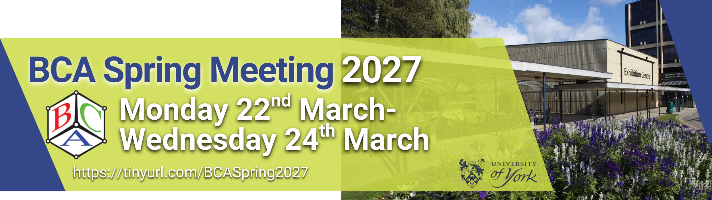



## Registration is open for 2026 British Crystallography Meeting
Registration and abstract submission is now open for the 2026 British Crystallography Association annual meeting, held at the University of York from 22 March - 24 March 2027. We are delighted to welcome <a href "https://www.durham.ac.uk/staff/jon-steed/"> Prof Jon Steed (University of Durham)</a> as the CCG Plenary Speaker!

Further information and registration details can be found <a href="https://hg3.co.uk/bca/">
  here
</a>

## CCG AGM at the 2026 BCA
If you are attending the 2026 CCG AGM you can access the agenda and previous meeting minutes <a href="https://bham-my.sharepoint.com/personal/a_a_l_michalchuk_bham_ac_uk/_layouts/15/guestaccess.aspx?share=IgBwPUeuCyGDTIixP2esRVXqAbzUh-09l8n897x-JS1Yt90&e=BFlLMr">  here </a>
